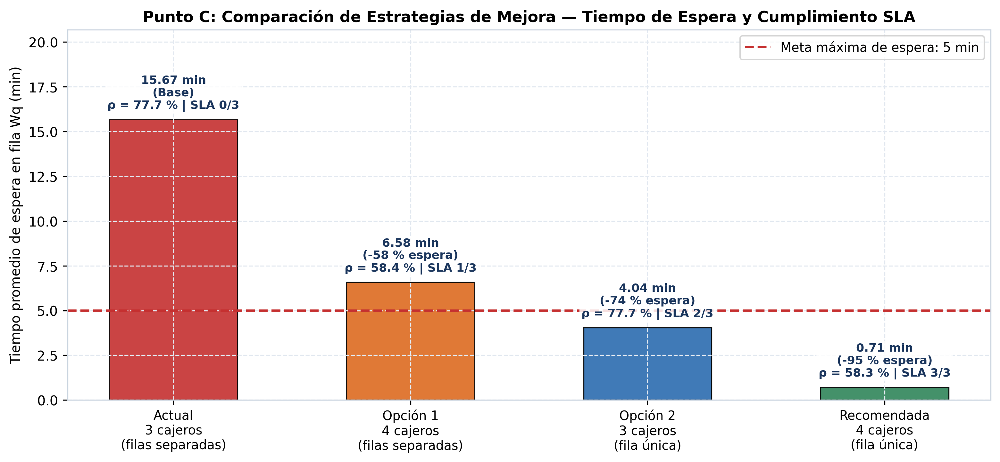

# Simulación de Parqueaderos — Centro Comercial Supercentro

**Curso:** S30 – Módulo 4: Actividad Didáctica 2 (`ACT4`)  
**Institución:** Institución Universitaria Digital de Antioquia (IUDigital)  
**Integrantes:**
- **Raul Santiago Morales Henao**
- **David Octavio Castro Mora**

**Cuaderno en Google Colab:**  
[](https://colab.research.google.com/github/shenao356/simulacion-parqueaderos-supercentro/blob/main/notebooks/Simulacion_Parqueaderos_Supercentro.ipynb)

---

## 1. Resumen del Problema

Cada salida del **Centro Comercial Supercentro** opera con **3 cajeros automáticos M/M/1** con filas separadas, sin cambio ni deserción. Los usuarios interactúan según cuatro perfiles: **Rápido (25 %, 1 min)**, **Normal (20 %, 3 min)**, **Lento (27.5 %, 4 min)** y **Muy lento (27.5 %, 6 min)**. El estudio evalúa mediante simulación en **Python (SimPy)** si tres cajeros son suficientes o qué mejora conviene implementar.

---

## 2. Estructura del Proyecto

```text
.
├── main.py                                            # Ejecuta toda la simulación y genera entregables
├── requirements.txt                                   # Librerías necesarias
├── pytest.ini                                         # Configuración de pruebas unitarias
├── notebooks/
│   └── Simulacion_Parqueaderos_Supercentro.ipynb      # Cuaderno resumido y ejecutado para Google Colab
├── src/
│   ├── simulacion.py                                  # Modelo SimPy, estado estable, Puntos A–E
│   ├── graficas.py                                    # 5 gráficas claras en Matplotlib (300 DPI)
│   └── generar_entregables.py                         # Genera Word (APA 7), Excel y cuaderno Colab
├── tests/
│   └── test_modelo.py                                 # 4 pruebas automáticas de verificación (Pytest)
└── resultados/
    ├── resultados_simulacion.xlsx                     # Libro Excel con las 6 tablas de resultados
    ├── graficas/                                      # 5 gráficas PNG (300 DPI)
    └── tablas/                                        # 6 archivos CSV de respaldo
```

---

## 3. Cómo Reproducir la Simulación

```bash
python3 -m venv .venv
source .venv/bin/activate        # En Windows: .venv\Scripts\activate
pip install -r requirements.txt

pytest -v                        # Verifica el motor de simulación
python main.py                   # Genera tablas, 5 gráficas, Excel, Word APA 7 y Colab
```

---

## 4. Resultados Principales

* **Estado estable (`R*`):** `160` réplicas independientes (error de estimación `3.0 %` < `5 %`).
* **Punto A (Menor y mayor tiempo por cajero):** Menor en **Cajero 3 (`19.08 min`)** y mayor en **Cajero 2 (`19.41 min`)** (ANOVA `p = 0.914`, sin diferencia significativa).
* **Punto B (Usuarios por tipo en los 3 cajeros):** `1,298.6` usuarios por corrida estable (`38.8/h`): `25.0 %` rápidos, `20.0 %` normales, `27.3 %` lentos y `27.6 %` muy lentos.
* **Punto C (Estrategia de mejora):** 3 cajeros con filas separadas **no alcanzan** (`Wq = 15.67 min`, 0/3 criterios). Unificarlos en **fila única** recorta la espera un **74.2 %** (`4.04 min`) sin comprar equipos, y la estrategia recomendada de **4 cajeros con fila única** reduce la espera un **95.5 %** (`0.71 min`, ocupación `58.3 %`, cumple **3/3 criterios**).
* **Punto D (Verificación, Calibración y Validación):** Error máximo frente a M/M/1 analítico `< 0.5 %`, Ley de Little `< 0.9 %`, sensibilidad confirmada y pruebas de carga coherentes.
* **Punto E (Eliminación del estado transitorio):** Corte automático en `t0* = 390 min` (Welch + MSER), corrigiendo el sesgo inicial en `Wq` (`14.99 → 15.67 min`, `+4.5 %`).


